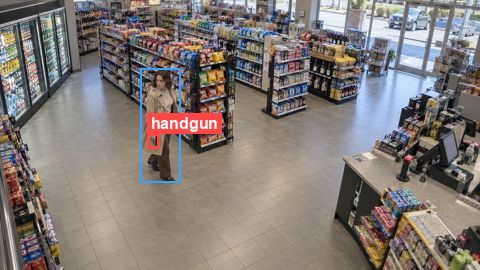
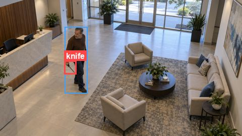
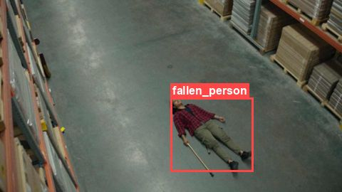

# Simuletic

**Synthetic CCTV and security datasets for computer vision.** Weapons, knives, falls, fights, shoplifting, fire and drones, seen from real CCTV camera angles, with hard negatives, labelled in YOLO and COCO. No real people, so no privacy problem.

[Website](https://simuletic.com/?utm_source=github&utm_medium=profile&utm_campaign=profile) · [All datasets](https://simuletic.com/datasets?utm_source=github&utm_medium=profile&utm_campaign=profile) · [Hugging Face](https://huggingface.co/Simuletic) · contact@simuletic.com

## Free dataset samples on GitHub

Each repo has a free sample with YOLO and COCO labels, hard negatives, a Colab notebook that fine-tunes YOLO11, and a link to the full 1,000-image dataset.

<table>
<tr>
<td width="33%" valign="top">
 
<b><a href="https://github.com/Simuletic/cctv-weapon-dataset">CCTV Weapon Detection</a></b> 
person, handgun, rifle, shotgun, sniper_rifle 
<a href="https://simuletic.com/datasets/cctv-weapon-detection-dataset?utm_source=github&utm_medium=profile&utm_campaign=profile">Full 1K dataset</a>
</td>
<td width="33%" valign="top">
 
<b><a href="https://github.com/Simuletic/cctv-knife-detection-dataset">CCTV Knife Detection</a></b> 
person, knife 
<a href="https://simuletic.com/datasets/cctv-knife-detection-dataset?utm_source=github&utm_medium=profile&utm_campaign=profile">Full 1K dataset</a>
</td>
<td width="33%" valign="top">
 
<b><a href="https://github.com/Simuletic/cctv-fall-detection-dataset">CCTV Fall Detection</a></b> 
person, fallen_person 
<a href="https://simuletic.com/datasets/cctv-fall-incident-detection-dataset?utm_source=github&utm_medium=profile&utm_campaign=profile">Full 1K dataset</a>
</td>
</tr>
</table>

Also: [cctv-aggressive-poses-fight-detection-dataset](https://github.com/Simuletic/cctv-aggressive-poses-fight-detection-dataset) (aggressive poses and fights) · [full dataset](https://simuletic.com/datasets/cctv-aggressive-pose-detection-dataset?utm_source=github&utm_medium=profile&utm_campaign=profile)

Full datasets: one-time licence, **$149 research** or **$590 commercial**. Larger sets (5,000 or 10,000 images) on request.

## More free samples on Hugging Face

| Area | Datasets |
|---|---|
| Security CCTV | [Weapon](https://huggingface.co/datasets/Simuletic/cctv-weapon-dataset) · [Knife](https://huggingface.co/datasets/Simuletic/cctv-knife-detection-dataset) · [Rifles vs umbrellas](https://huggingface.co/datasets/Simuletic/CCTV_Weapon_Detection_Rifles_vs_Umbrellas) · [Handgun vs bag of chips](https://huggingface.co/datasets/Simuletic/Weapon_Detection_Dataset_Handgun_vs_BagOfChips) · [ATM robbery](https://huggingface.co/datasets/Simuletic/CCTV_ATM_Robbery_Detection_Dataset_Gun_Knife) · [Aggressive poses / fights](https://huggingface.co/datasets/Simuletic/CCTV_Aggressive_Poses_Fight_Detection_Dataset) · [Pedestrian attributes](https://huggingface.co/datasets/Simuletic/CCTV-Pedestrian-1K-Person-Attribute-Dataset) |
| Safety | [Fall / lying down](https://huggingface.co/datasets/Simuletic/CCTV_Incident_Dataset_Fall_Lying_Down_Detection) · [Smoke and fire](https://huggingface.co/datasets/Simuletic/CCTV-Smoke-Fire-Emergency-Detection-Dataset) · [Long-distance wildfire smoke](https://huggingface.co/datasets/Simuletic/Long_Distance_Wildfire_Smoke_Detection_Dataset) · [Driver drowsiness](https://huggingface.co/datasets/Simuletic/Driver_Drowsiness_Monitoring_Detection_Dataset) |
| Drones and aerial | [Airport drone threats](https://huggingface.co/datasets/Simuletic/Airport_Drone_Threat_And_Safety_Dataset) · [Drone swarms](https://huggingface.co/datasets/Simuletic/Military-Drone-Swarm-Saturation-Attack-Dataset) · [UAV view: battle tanks](https://huggingface.co/datasets/Simuletic/UAV-Aerial-View-Battle-Tank-Detection-Dataset) |
| Vision-language | [Surveillance VLM: weapon and knife captions](https://huggingface.co/datasets/Simuletic/Surveillance-VLM-Weapon-Knife-Detection-Dataset) |

## Tools

- [simuletic-vision](https://github.com/Simuletic/simuletic-vision): Python toolkit to validate YOLO-format datasets and train, evaluate and run RF-DETR detectors on synthetic and real data.

## Services

- **[Custom datasets](https://simuletic.com/custom-data?utm_source=github&utm_medium=profile&utm_campaign=profile)** rendered into your own camera views and classes, as images or video clips.
- **[False-Positive Stress Test](https://simuletic.com/stress-test?utm_source=github&utm_medium=profile&utm_campaign=profile)**: we run your detector against hard negatives and edge cases and send a failure report.

## Contact

contact@simuletic.com · [simuletic.com/contact](https://simuletic.com/contact?utm_source=github&utm_medium=profile&utm_campaign=profile)
